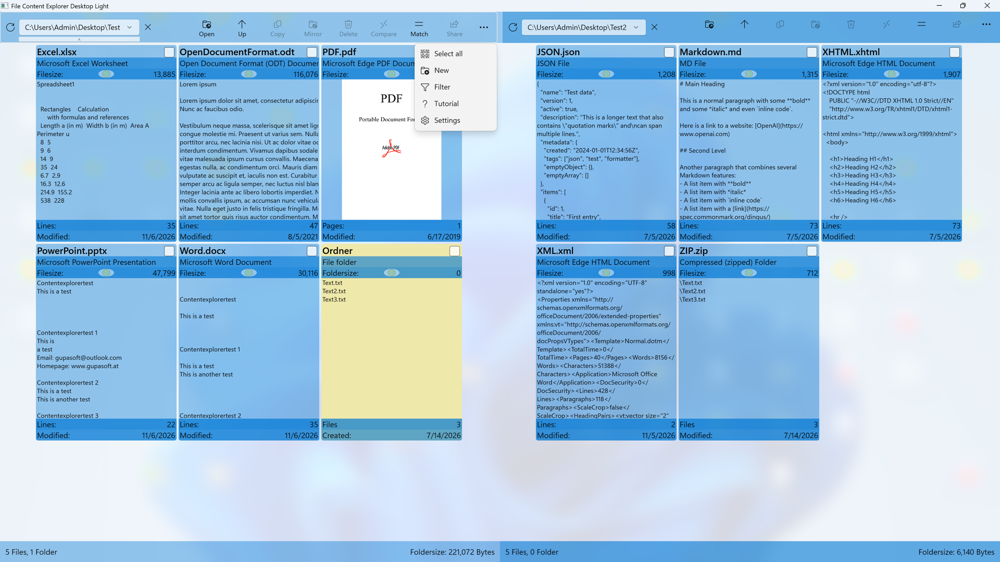
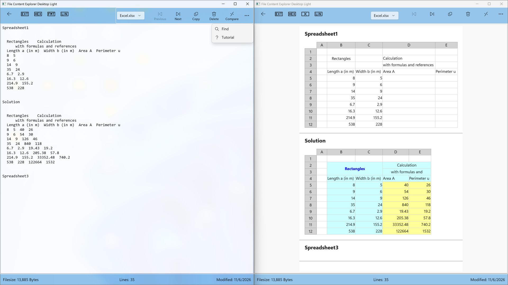
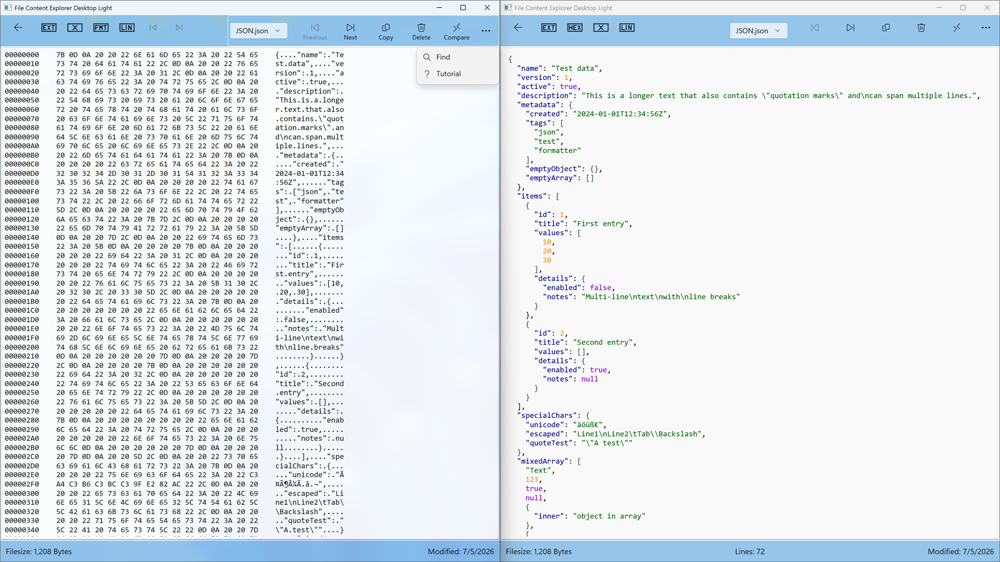
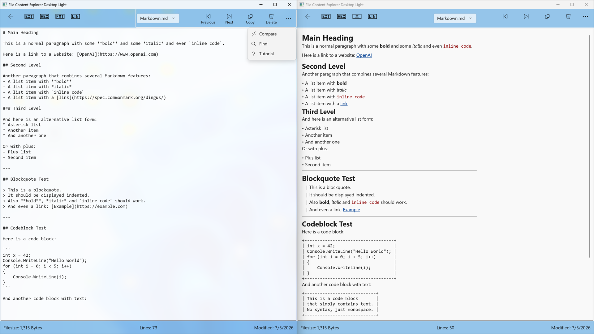
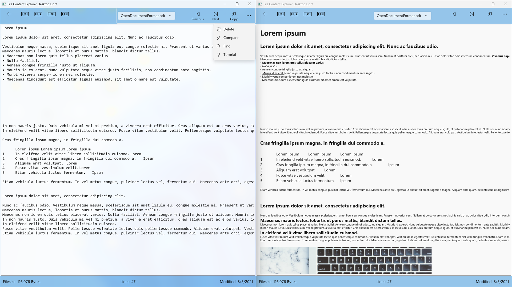
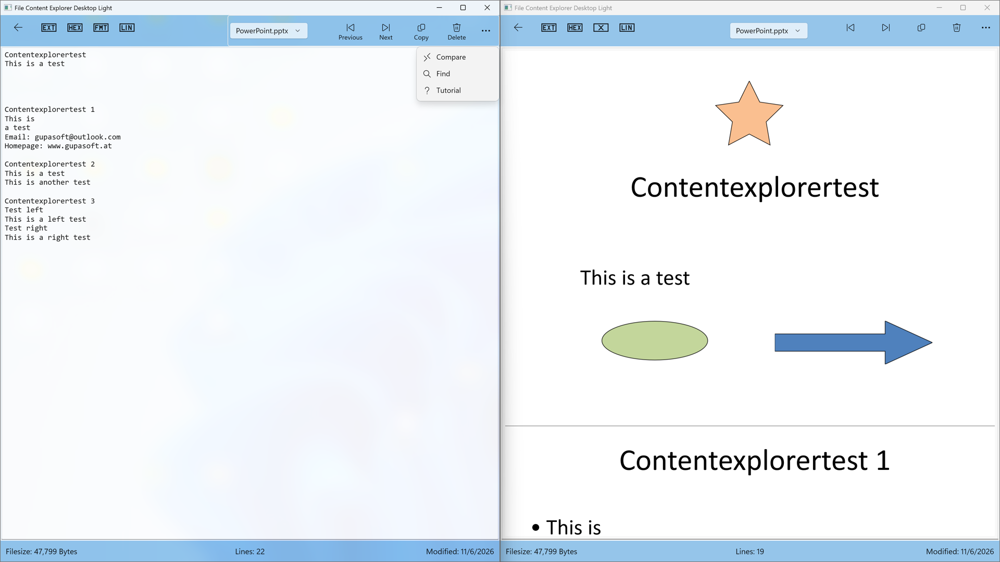
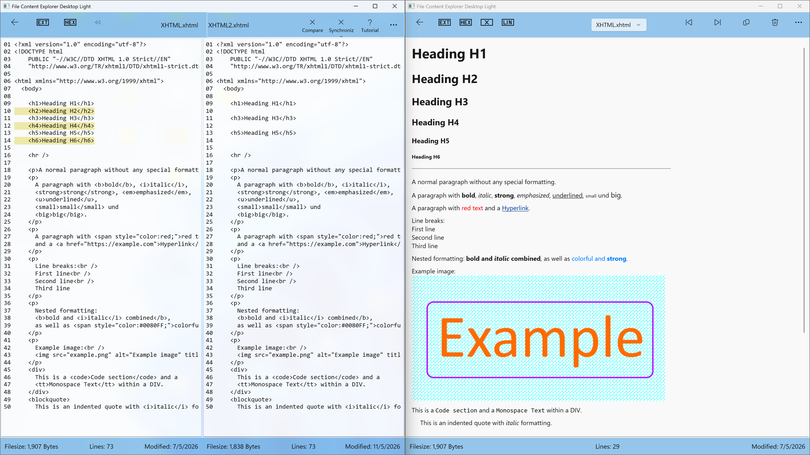
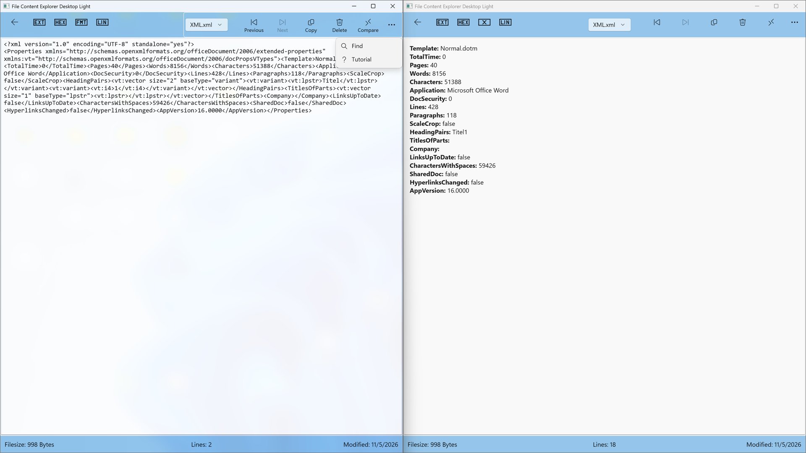

# File Content Explorer Desktop Light
Evaluation version of powerful, multi-lingual file manager and viewer designed for power users, developers, and security analysts. This portable version is built with C# Native AOT, making it extremely lightweight, lightning-fast, and standalone.

It specializes not just in browsing files, but in **deep inspection and side-by-side comparison** of advanced file types.

---

## 🚀 The Ultimate Sandbox Tool
Unlike the Microsoft Store version, **this portable version runs seamlessly inside the Windows Sandbox** and other restricted environments. 
* Inspect, hash, and preview suspicious or isolated files safely inside your sandbox without any installation.
* Zero external dependencies—runs directly from a USB stick or a temporary folder.

---

## ✨ Key Features & Deep Inspection

*   **Advanced File Previews & Detail Views:** Inspect structures directly inside the manager:
    *   *Documents:* MS Office, OFD, PDF, XPS, eBooks.
    *   *Code & Data:* Formatted Markdown, JSON, XML, XHTML, and plain text.
    *   *Media & Archives:* Images, videos, ZIP files.
*   **Built-in Hex Viewer & Comparison:** 
    *   View any file in raw Hex format.
    *   **Side-by-side Hex comparison** (Completely unlimited in this version!).
*   **File Comparison:** Compare two text, XML, JSON, or source code files with syntax highlighting.
*   **Security & VirusTotal Integration:** 
    *   Generate SHA256 hashes for any file.
    *   Upload files directly to **VirusTotal** to check for malware with one click.
*   **Unique Folder Content Hashing:** Generate a combined SHA256 hash for entire directory structures. Compare two folders instantly based on content, **regardless of file names or subfolder structures**.

---

## 📥 Download & Evaluation Limits

This repository hosts the **Free Evaluation & Portable Version** of the app. It writes all settings and filters into its own directory (XML files) and does not touch your Windows Registry.

| Feature | Portable Evaluation Version | Full Version (Microsoft Store) |
| :--- | :--- | :--- |
| **Windows Sandbox Support** | ✅ Yes (Fully Supported) | ❌ No (Store Restrictions) |
| **Hex Viewer & Hex Compare** | ♾️ Unlimited | ♾️ Unlimited |
| **VirusTotal & Folder Hashing** | ♾️ Unlimited | ♾️ Unlimited |
| **Files visible per Folder** | ⚠️ Max. 5 files | ♾️ Unlimited |
| **Office/Code Preview & Diff** | ⚠️ Max. 50 lines | ♾️ Unlimited |
| **Updates** | 🔄 Manual Download | 🚀 Automatic via Store |

### How to run:
1. Go to [Releases](https://github.com) and download the latest `.zip` file.
2. Extract the ZIP file to any folder or USB drive.
3. Launch the `.exe` file. *(Note: Since this portable version is not digitally signed, Windows SmartScreen may show a warning on the very first launch. You can safely click "More info" -> "Run anyway").*

---

## 💎 Get the Full Version
If you need to manage large directories without the 5-file limit, or need full-length document previews and file comparisons, please support the development by getting the Full Version:

👉 **[Download the Full Version from the Microsoft Store](https://www.microsoft.com/store/apps/9PPHPDWBZ16N)**

*The Full Version includes automatic updates, supports the developer, and removes all view/line limitations.*  
💡 Note on Screenshots: The detail views below show two separate instances of the app opened side-by-side to showcase more features and formats at once.

---

## 📸 Application Screenshots & File Views
*Click on an image to view it in full resolution (1920x1080).*

<table>
  <tr>
    <td width="50%">
      
<b>Main Overview & Dashboard</b>

      
    </td>
    <td width="50%">
      
<b>Excel Viewer</b>

      
    </td>
  </tr>
  <tr>
    <td>
      
<b>JSON Inspector</b>

      
    </td>
    <td>
      
<b>Markdown Preview</b>

      
    </td>
  </tr>
  <tr>
    <td>
      
<b>Open Document Format</b>

      
    </td>
    <td>
      
<b>PowerPoint Viewer</b>

      
    </td>
  </tr>
  <tr>
    <td>
      
<b>XHTML Viewer</b>

      
    </td>
    <td>
      
<b>XML Deep Inspection</b>

      
    </td>
  </tr>
</table>
